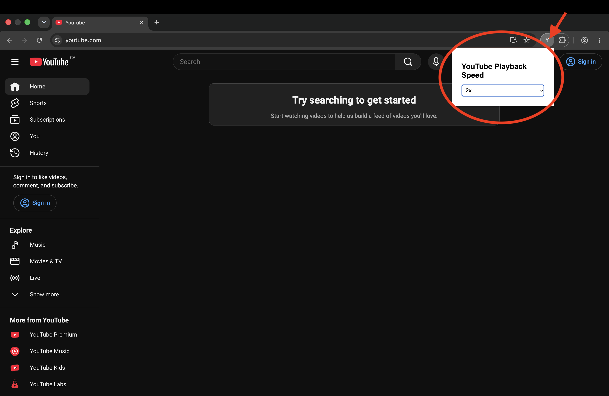
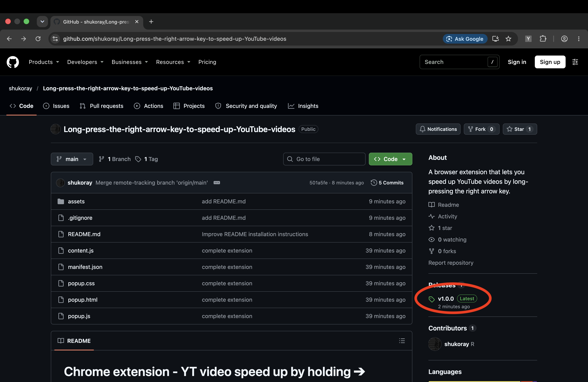
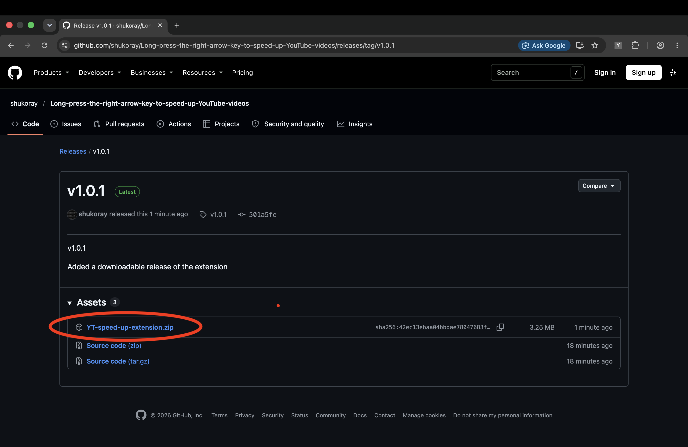
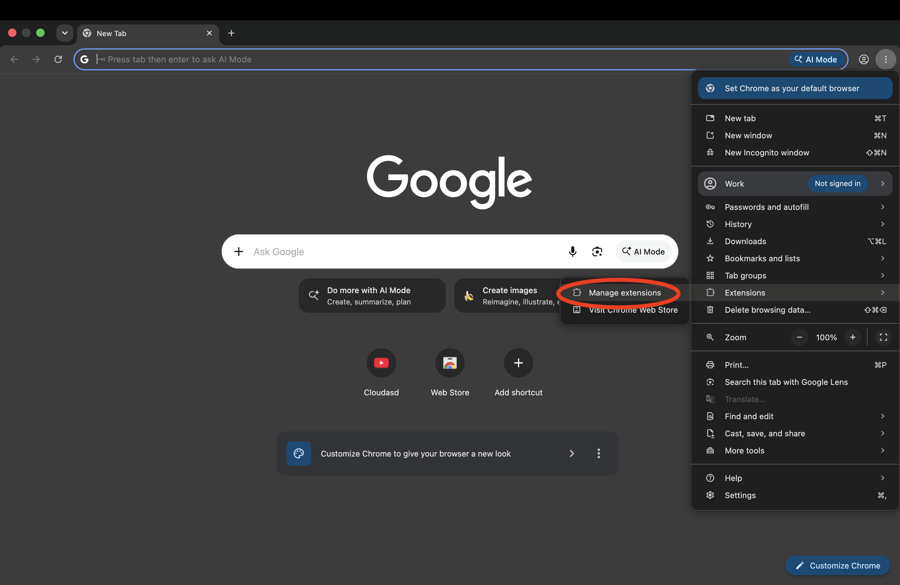
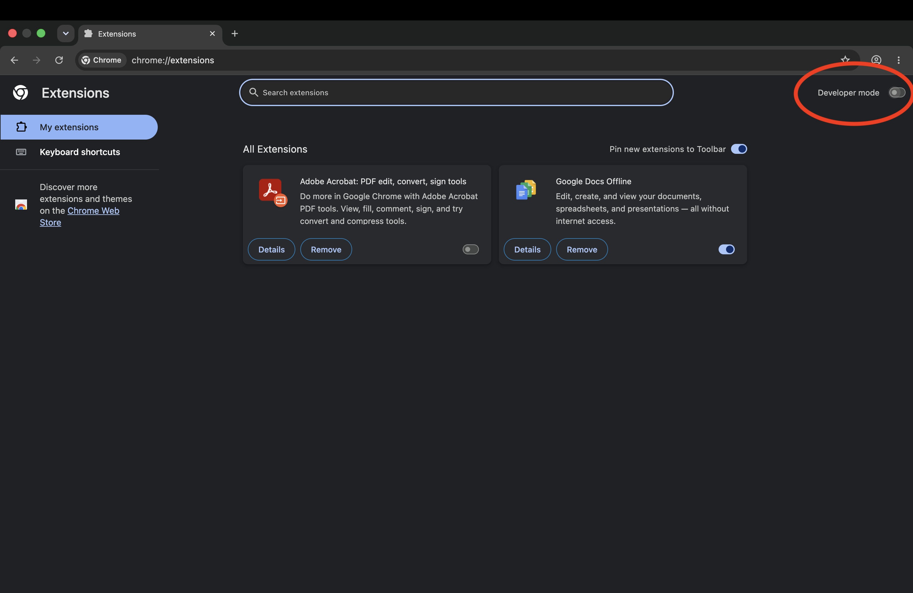
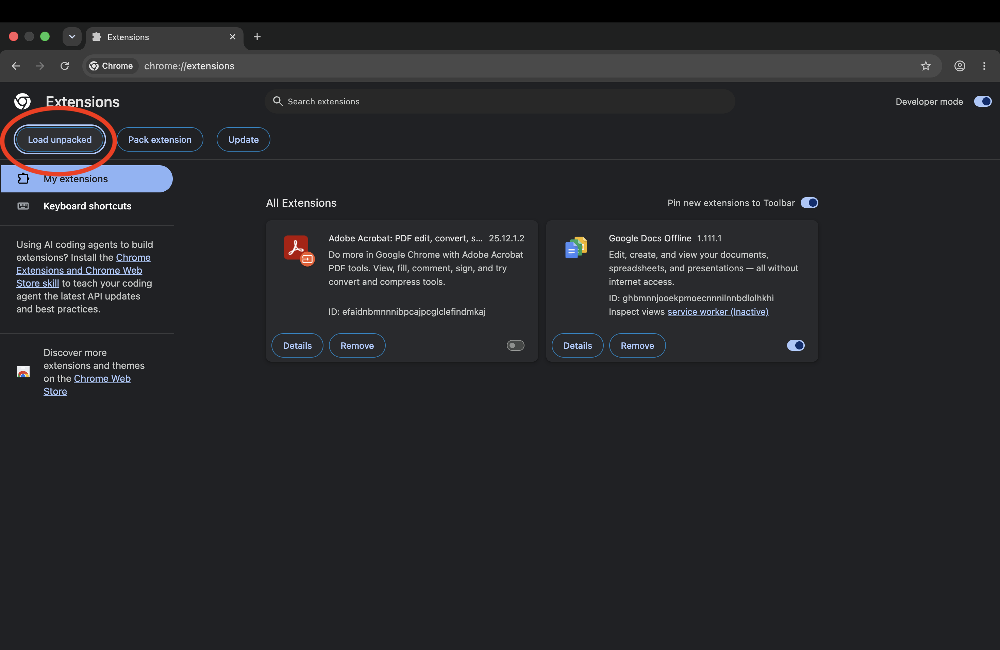
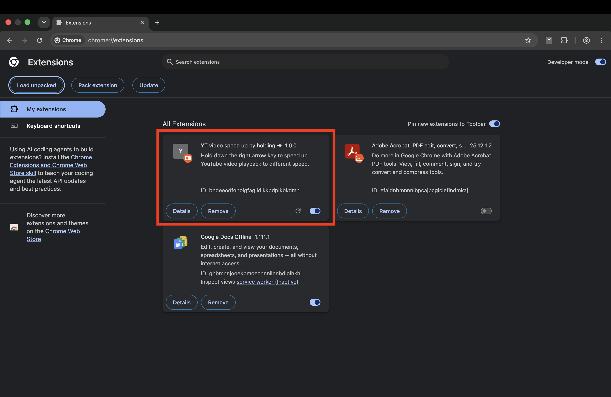

# Chrome extension - YT video speed up by holding ➔

## Features

- **Hold down the right arrow key** to speed up YouTube video playback, pressing the right arrow key retains the existing +5 second function.

- Change playback speed in popup window

## How to use
1. Download the extension. Go to Release ➔ click YT-speed-up-extension(.zip) to download

2. Go to Customize and control Google Chrome ➔ Extensions ➔ Manage extensions

3. Turn on Developer mode

4. Click Load unpacked and upload the extension file

5. Congratulations! You complete the installation. Now go to YouTube and try the speed up feature

